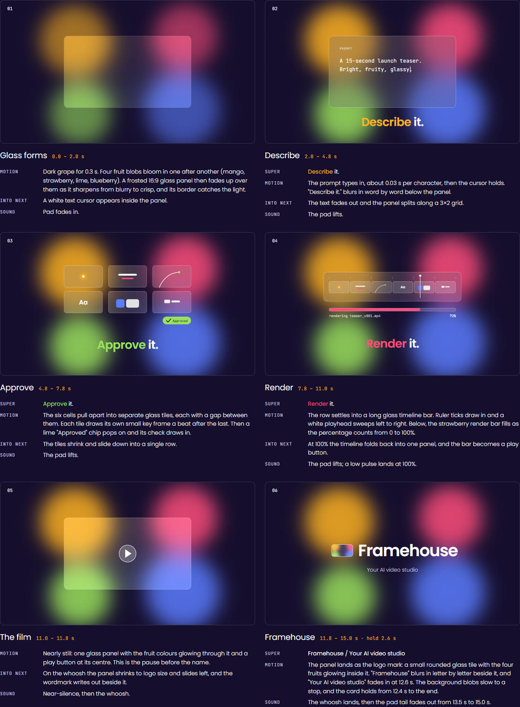
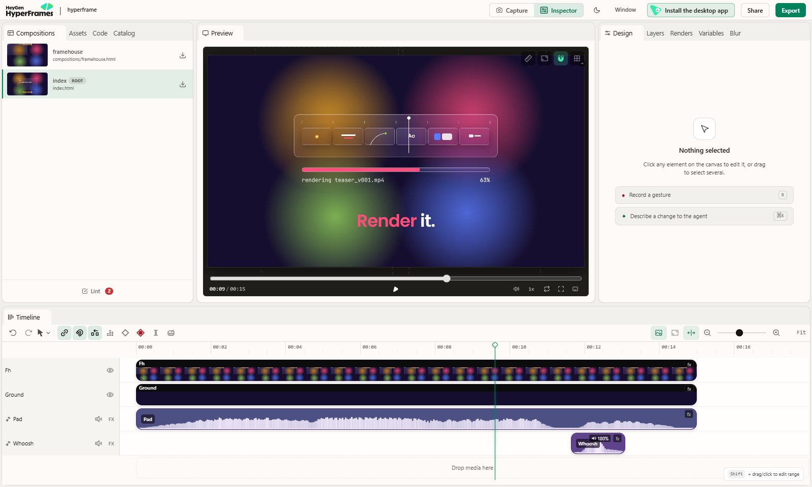
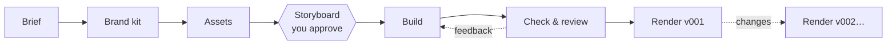

<div align="center">

# Framehouse

**Describe the video. Drop in your assets. Approve the storyboard. Get the MP4.**

An AI-agent video studio for trailers, teasers, promos, explainers and social cuts,
built on [HyperFrames](https://hyperframes.heygen.com) (HTML + GSAP, rendered to video).

[](https://nodejs.org)
[](https://hyperframes.heygen.com)
[](#3--open-the-folder-in-your-agent)

<br>


<sub>This teaser was made by Framehouse from <a href="#4--run-the-demo">one prompt</a> with no assets: storyboard, build, checks and render.</sub>

</div>

---

## Why Framehouse

- **Many productions, one workspace.** A game trailer today, a product teaser tomorrow, a vertical reel next week. Each one keeps its brief, brand kit, assets, storyboards and renders together.
- **Storyboard first.** Before anything is built, the agent draws a visual board (one frame per beat, in your brand's colours and fonts) and waits for your approval.
- **A brand kit per project.** Built from the logo, guidelines or website you send, or proposed for you. Repeat clients get their kit back automatically.
- **Nothing gets overwritten.** Renders are versioned (`v001`, `v002`, …), and every round is logged in the project's `CHANGELOG.md`.
- **Agent-agnostic.** Works with Claude Code, Gemini CLI / Antigravity, Codex and Cursor.

---

## Getting started

### 1 · Install the prerequisites

| Requirement | How to get it |
| --- | --- |
| **Node.js ≥ 22** | [nodejs.org](https://nodejs.org) |
| **FFmpeg** on your `PATH` | Windows `winget install ffmpeg` · macOS `brew install ffmpeg` · Linux `apt install ffmpeg` |
| **Chrome / Chromium** | Your installed Chrome works, or run `npx hyperframes browser` |
| **HyperFrames agent skills** | `npx hyperframes skills update`, then **restart your agent** |

> [!NOTE]
> The HyperFrames skills (`hyperframes`, `hyperframes-cli`, `hyperframes-registry`, `media-use`, …) aren't stored in this repo. They install into your user folder (`~/.claude/skills`, `~/.agents/skills`, `~/.gemini/skills`), where every agent can find them.

### 2 · Clone and check

```bash
git clone <this-repo> framehouse
cd framehouse
npm run doctor        # checks Node, Chrome and FFmpeg
```

There are no root dependencies, so you don't need to run `npm install`.

### 3 · Open the folder in your agent

| Agent | Reads | Notes |
| --- | --- | --- |
| **Claude Code** | `CLAUDE.md` | Finds the `video-studio` skill in `.claude/skills/` on its own |
| **Gemini CLI / Antigravity** | `GEMINI.md` (+ `AGENTS.md` via `.gemini/settings.json`) | Told exactly which skill files to read |
| **Codex / Cursor / others** | `AGENTS.md` | If it doesn't pick up the workflow, point it at `.claude/skills/video-studio/SKILL.md` |

### 4 · Run the demo

Paste this into your agent. It needs **no assets**: everything is built from type, shape and light, so it's a good first test of the whole pipeline. The video it makes is a teaser for Framehouse itself.

```text
Make a new production called "Framehouse Teaser" with one cut: teaser, landscape, 15 seconds.

Framehouse is an AI-agent video studio: you describe a video, drop in your assets,
approve a storyboard, and get a finished MP4.
Make a bright, polished motion teaser in the style of a modern software launch:
- Look: fruity glassmorphism. Soft blobs of mango, strawberry, lime and blueberry
  drifting behind frosted-glass panels on a deep grape background, with a rounded
  geometric sans. Propose the exact kit and show it with the storyboard.
- Hook in the first 2 seconds: the colour blobs bloom out of the dark and a frosted
  16:9 glass panel forms over them.
- Tell the workflow as one continuous story: a prompt types into the glass panel, it
  splits into glass storyboard tiles, the tiles slide into a timeline, a render bar fills.
- Kinetic type for three short lines: "Describe it." / "Approve it." / "Render it.",
  each with its keyword in a different fruit colour.
- One canvas, no hard cuts: each step morphs into the next.
- End card: "Framehouse" wordmark + "Your AI video studio", held for at least 2 seconds.
- No footage or photos. Add a subtle music bed + one whoosh if you can source royalty-free
  ones; otherwise leave it silent and say so.

Show me the visual storyboard before you build. After I approve, build it, check it,
show me snapshot stills, then render the final.
```

What happens next:

1. The agent creates `projects/framehouse-teaser/` and fills in `brief.md`.
2. It proposes a brand kit and a **visual storyboard**, then **waits for your approval**. The board looks like this:

<p align="center">
  
</p>

3. It builds `cuts/teaser/`, runs the checks and shows you snapshot stills.
4. It renders `projects/framehouse-teaser/renders/teaser_v001.mp4`.

Ask for changes ("slower intro", "make the accent teal") and you get `teaser_v002.mp4`.

---

## Preview and edit in the HyperFrames editor

Framehouse builds on [HyperFrames](https://hyperframes.heygen.com), and every cut is a full HyperFrames project. That means you can open any cut in the HyperFrames editor in your browser. Watch it at full speed, scrub the timeline, click any element to adjust it, and check the audio tracks before you render.

<p align="center">
  
  <br>
  <sub>The HyperFrames editor (by HeyGen) with a cut open: preview, timeline and audio tracks.</sub>
</p>

```bash
npm run studio -- preview <project> <cut>
# e.g.  npm run studio -- preview framehouse-teaser teaser
```

The terminal prints the editor's address (e.g. `http://localhost:3002`). Open it in Chrome. Stop the editor with `Ctrl+C`.

| Panel | What you can do |
| --- | --- |
| **Preview** | Play and scrub the cut at full resolution; toggle safe-area guides |
| **Timeline** | See every picture and audio track; move, trim and retime clips |
| **Design** | Click an element on the canvas to change its text, colour, size or position |
| **Variables / Renders** | Swap copy and colours exposed as variables; see past renders |
| **Lint** | The same checks the agent runs before rendering |

Edits you make in the editor are saved straight back into the cut's HTML files, so your agent sees them the next time it works on that cut. When you're happy, ask your agent to render, or run `npm run render -- <project> <cut>`.

> [!TIP]
> **Agents start the editor differently.** They run `npm run studio -- preview <project> <cut> --background`, which keeps it running after their command ends. To stop it, run `npx hyperframes preview projects/<project>/cuts/<cut> --stop`.
>
> **Prefer a desktop app?** The [HyperFrames desktop app](https://hyperframes.studio/studio/download) opens the same projects and lets you make edits by chatting with its built-in assistant, Framey.

---

## Making a real video

```bash
# 1. Create the production and its deliverables (or just ask the agent)
npm run new -- "Skyforge Launch" --client "Skyforge Games" --cut trailer --cut teaser:portrait:15

# 2. Drop your raw files into projects/skyforge-launch/inbox/
#    logo, brand guide, footage, screenshots, music, reference videos…
```

Then ask your agent:

> *"Make the Skyforge trailer and a vertical teaser. It's a co-op airship game launching March 3,
> CTA: wishlist on Steam. Epic but fun. Assets are in the inbox. Here's a reference trailer I
> like: &lt;link&gt;."*

**For a good brief, include** who it's for, where it'll be posted, the one message, the call to action, the tone, and any hard facts (dates, prices, names). The agent never invents claims. Anything missing becomes a marked placeholder or a listed assumption.

### The workflow



Every step is logged in the project's `CHANGELOG.md`, so you or another agent can pick a project up later without the earlier conversation. The full rules are in [`.claude/skills/video-studio/SKILL.md`](.claude/skills/video-studio/SKILL.md).

### Cut specs

The format is `name[:resolution[:seconds]]`, for example `trailer`, `teaser:landscape:15` or `reel:portrait:30`.

- **Named cuts with defaults:** trailer · teaser · promo · explainer · intro · outro · reel · short · story · post
- **Resolutions:** `landscape` · `portrait` · `square` · `landscape-4k` · `portrait-4k` · `square-4k`

---

## Project layout

```
framehouse/
├─ studio.config.json        pinned HyperFrames version + defaults (fps, quality)
├─ CLAUDE.md · GEMINI.md · AGENTS.md    agent instructions
├─ docs/                     README media
├─ library/                  optional: saved brand kits, music, sfx, fonts…
├─ projects/<slug>/          one production
│  ├─ brief.md               requirements (source of truth for intent)
│  ├─ project.json           cuts, sizes, durations, status
│  ├─ CHANGELOG.md           every cut, feedback round and render
│  ├─ inbox/                 your raw files (never modified)
│  ├─ assets/                cleaned, render-ready media
│  │  └─ brand/brand.json    this project's own brand kit
│  ├─ notes/                 scripts, research, stills
│  ├─ cuts/<cut>/            one HyperFrames project per deliverable (+ storyboard)
│  └─ renders/               <cut>_v001.mp4, v002… never overwritten
└─ .claude/skills/video-studio/   the portable skill: SKILL.md, CLI, templates, format guides
```

> [!IMPORTANT]
> **Not in git** (see `.gitignore`): raw media in `inbox/`, everything in `renders/`, and `.mov` / ProRes files. Share these through a drive, or use Git LFS if you want them versioned.

---

## CLI

`npm run studio -- help` lists every command. Shortcuts: `npm run new | list | check | render | doctor`.

<details>
<summary><b>All commands</b></summary>

| Command | What it does |
| --- | --- |
| `new <name> [--client c] [--brand kit] [--cut spec]…` | New production with its own brand kit |
| `add-cut <project> <spec>` | Another deliverable for an existing production |
| `save-brand <project> [name]` | Save a project's brand kit for a repeat client |
| `list` | All productions, cuts and render counts |
| `sync <project>` | Mirror `assets/` into every cut (check, preview and render do this automatically) |
| `check <project> [cut]` | Lint + runtime + layout + motion checks |
| `snapshot <project> [cut] --at 1,4,9` | PNG stills for review |
| `preview <project> [cut]` | Open the cut in the HyperFrames editor |
| `render <project> [cut\|all] [--draft] [--quality delivery] [--format mp4\|webm\|mov\|gif]` | Versioned render |
| `status <project> <stage>` | brief · storyboard · building · review · rendered · delivered · archived |
| `doctor` | Check Node, Chrome and FFmpeg |

</details>

---

## Brands: one per project

Every project has its own brand kit at `assets/brand/brand.json`, because every client and product looks different. Send whatever you have (a logo, brand guidelines, a website, past videos, or just "make it feel premium"). The agent builds the kit from it, or proposes one for you to approve along with the storyboard.

**Repeat client?** After the first project, run `npm run studio -- save-brand <project>`. Next time, `--client "<Name>"` starts from their saved kit automatically. For a filled-in example, see [`library/brands/_example`](library/brands/_example).

---

## Troubleshooting

| Problem | Fix |
| --- | --- |
| Agent skips the storyboard or ignores the workflow | Tell it: *"Read `.claude/skills/video-studio/SKILL.md` and follow it."* |
| Agent says the `hyperframes` skill is missing | Run `npx hyperframes skills update`, then restart the agent |
| `doctor` fails on FFmpeg | Install it, then check that `ffmpeg -version` works in a new terminal |
| Render can't find Chrome | `npx hyperframes browser` |
| Editor page won't load | Check the address the preview command printed; if the port is busy, stop the old preview first |
| No music in the video | Sign in for the free HeyGen music catalog: `npx hyperframes auth login` |
| Media missing after cloning | `inbox/` and `renders/` aren't in git; copy them from wherever your team shares media |

---

## Reusing the skill elsewhere

Everything reusable lives in `.claude/skills/video-studio/`. To use it in another repo, copy that folder into that repo's `.claude/skills/` (or into `~/.claude/skills/` for all your projects), then run:

```bash
node .claude/skills/video-studio/scripts/studio.mjs init
```

## License

[MIT](LICENSE). HyperFrames, which Framehouse builds on, is Apache-2.0 and is not part of this repository.
